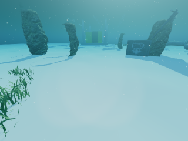
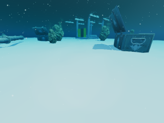
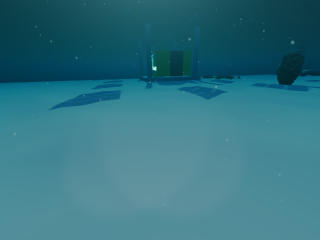
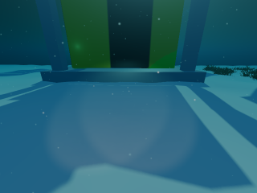

# UUV 充电站避障导航场景（Stonefish + USIM 传感器/数据格式）

本目录在 [Stonefish](https://github.com/patrykcieslak/stonefish) v1.5 中搭建了一个
**UUV 从湖泊入口出发、穿越岩石/集装箱/管道障碍区、最终抵达太阳能充电站的避障导航场景**。
UUV 的传感器布置、状态/动作定义、相机画幅、采样率与数据字段均按 USIM 数据集
（`goto_charge_station` 导航任务）对齐，输出的数据可直接作为 **LeRobot v2.1** 数据集
用于 **OpenPI π0.5**（`pi05_u0bot` 配置）微调。

> 场景与数据管线已完成端到端验证：13 个示例 episode（10 train + 3 test，`--jobs 3`
> 并发采集）全部成功到达充电站；巡航深度 **2.2 m**，单集约 226–411 帧 / 24–42 秒；
> 每集第一帧都能看到充电站目标板（6 集完整可见，7 集部分遮挡，保证至少 2/3 靶板
> 采样点可见）。转换后的 LeRobot 数据集通过 `scripts/validate_lerobot.py` 的结构校验。

> **仓库说明**：`episodes_raw/`（本地原始 PNG/CSV，默认不入库）和 `build/` 不入库；
> 仓库保留 `datasets/usim/{train,test}` 转换后的示例数据集（约 5.5 MB）。原始数据可用
> `scripts/collect.py` 重新生成。README 命令里的
> `/media/ai/DATA1/dcw/stonefish/uuv_charge_nav` 是开发机路径，克隆到其他位置后
> 请替换为实际仓库路径。

---

## 1. 目录结构

```
stonefish/
├── stonefish/                 # Stonefish v1.5 源码（git clone）
├── build_stonefish/           # Stonefish 构建目录
├── install_stonefish/         # Stonefish 安装目录
└── uuv_charge_nav/            # 本场景工程
    ├── src/
    │   ├── main.cpp                    # 图形应用入口
    │   ├── NavSimulationManager.*      # 场景加载、10 Hz 采集、终止判定
    │   ├── Autopilot.*                 # 纯追踪 + 声呐避障 + 8 推进器分配
    │   ├── DataRecorder.*              # 原始 episode（PNG + CSV）记录
    │   └── EpisodeConfig.*             # episode.cfg / path.csv / obstacles.csv
    ├── data/
    │   ├── bluerov2/ charge/ solar_panel/ stone/ ...   # USIM/u0env 资源
    │   ├── flat.obj / SoilBeach0078_1_350.jpg
    │   ├── scenes/robots/bluerov2_usim_nav.scn         # USIM 同构 BlueROV2
    │   └── scenes/generated/                            # 生成的场景（可选）
    ├── scripts/
    │   ├── build.sh                    # 一键构建 Stonefish + 本工程
    │   ├── generate_episode.py         # A* 场景/路径/障碍生成器
    │   ├── collect.py                  # 批量采集 episode
    │   ├── collect_and_convert.sh      # 采集 + 转换 + 校验
    │   ├── run_scene.sh                # 一键切换并运行 scenes/ 里的场景
    │   ├── convert_to_lerobot.py       # 原始数据 -> LeRobot v2.1
    │   ├── validate_lerobot.py         # 数据集结构/视频/维度校验
    │   ├── summarize.py                # 原始 episode 质量汇总
    │   ├── make_dataset_card.py        # 生成 datasets/usim/README.md
    │   └── openpi_train_example.sh     # π0.5 训练命令示例
    ├── openpi_ext/                     # 官方 openpi 的 u0bot policy/config 片段
    ├── ros2/                           # ROS 2 相机发布 + RViz 配置
    ├── docs/images/                    # 场景/相机/RViz 截图
    ├── examples/demo_episode/          # 可直接运行的示例场景
    ├── scenes/{train,test}/episode_*/  # 13 个训练/测试场景（scene.scn + path + 预览）
    ├── episodes_raw/{train,test}/      # 原始 episode（本地生成，默认不入库）
    └── datasets/usim/{train,test}/     # 最终 LeRobot v2.1 数据集（示例已入库）
```

---

## 2. 快速开始

环境：Ubuntu 22.04、NVIDIA GPU（测试于 RTX 5090 / 驱动 580）、CMake ≥ 3.16、
OpenGL/SDL2/FreeType/OpenCV 已安装、ffmpeg 带 `libaom-av1` 编码器、Python 3.11。

```bash
cd /media/ai/DATA1/dcw/stonefish/uuv_charge_nav

# 0) Python 依赖（首次）
python3 -m venv ../.venv
source ../.venv/bin/activate
pip install -r requirements.txt

# 1) 构建（若父目录已有 Stonefish/install，可跳过对应步骤）
./scripts/build.sh

# 2) 采集 10 个训练集 + 3 个测试集 episode，并转换/校验
TRAIN_COUNT=10 TEST_COUNT=3 JOBS=3 ./scripts/collect_and_convert.sh
```

生成结果：

```
episodes_raw/train/episode_000000/     # scene.scn, path.csv, samples.csv, images/{ego,wrist}
datasets/usim/train/                  # LeRobot v2.1: data/ meta/ videos/
datasets/usim/test/
```

单集采集约 24–42 秒；`--jobs 3` 时 13 集约 3–5 分钟。转换（含 AV1 编码）也用
`--jobs 3` 并发处理，单集约 1–2 分钟。

### 只生成一个场景预览

```bash
source ../.venv/bin/activate
python scripts/generate_episode.py --out episodes_raw/demo --seed 7 --split debug
# episodes_raw/demo/scene.scn + preview.png + path.csv + obstacles.csv
```

### 手动运行单集

```bash
export LD_LIBRARY_PATH=/media/ai/DATA1/dcw/stonefish/install_stonefish/lib:$LD_LIBRARY_PATH
./build/uuv_nav \
  --scene "$PWD/episodes_raw/train/episode_000000/scene.scn" \
  --episode-dir "$PWD/episodes_raw/train/episode_000000"
```

> `--scene` 需要是绝对路径；`episode-dir` 里必须已有 `episode.cfg`、`path.csv`、
> `obstacles.csv`。

---

## 3. 场景说明

- **水域**：50 m × 30 m 浅水湖，水面 `z=0`，平坦湖底 `z=3.0 m`（Stonefish NED，z 向下）；
  巡航深度 **2.2 m**（离底约 0.8 m）。
- **起点**：充电站西侧 8–15 m 的随机位置，艏向朝向目标板；生成器强制目标板至少
  2/3 采样点可见，允许岩石对目标板形成部分遮挡。
- **充电站**：东侧 `(22.5, -11)`。包含
  - 湖底钢结构平台 + USIM `charge0/charge1` 充电垫；
  - 四根立柱支撑的水面太阳能板阵列（USIM `solar_panel` 资源）；
  - 面向来向的绿色/黄色识别靶板（`data/textures/dock_target.png`）；
  - 绿色信标灯。
- **目标点**：`(18, -11, 2.2)`，位于靶板前方约 2.3 m，朝向充电站（yaw=0）。
- **障碍物**：14–26 块随机岩石（`stone.obj` 随机尺度/朝向）、3–6 个随机闸门、
  1–2 个集装箱、可选管道，以及背景石块/水草；闸门随机分布在起终点之间，
  可能靠近甚至部分遮挡目标板。A* 路径会绕开它们。
- **随机化**：起点距离/方位、闸门数量/位置/侧向/尺度、集装箱/管道、背景岩石、
  目标遮挡程度、光照方位/高度、水体 Jerlov 系数（0.10–0.18）逐 episode 变化。
- **专家策略**：
  1. 生成阶段在 0.5 m 栅格上用 A*（障碍按机器人半径膨胀）规划全局路径；
  2. 运行时用纯追踪（lookahead 1.0 m，近障时 0.55 m）跟踪路径；
  3. 前视 90°/128 波束多波束声呐做局部排斥/减速，处理未建模或动态障碍；
  4. 串级速度控制 + PD 姿态 → 8 推进器归一化 PWM；
  5. 终点判定：距目标 < 0.30 m、艏向误差 < 0.10 rad、速度 < 0.55 m/s 连续 2 帧；
     末段使用带符号的刹车逻辑，避免越过目标后震荡。
- **失败判定**：与障碍圆/湖底/水面碰撞，或超过 75 s。


每集的 `preview.png` 可直接查看障碍、A* 路径、起点/目标/充电站相对位置。
仓库里的 `scenes/train/`（10 个）和 `scenes/test/`（3 个）保存了示例数据集对应的
完整生成场景文件；`scenes/README.md` 给出单独运行方法。它们只包含场景/路径/配置/预览，
不包含原始图像序列。

### 示例画面

| 起点：目标部分遮挡（2/3） | 起点：目标清晰（3/3） | 避障途中（ego） | 接近充电站（ego） |
|---|---|---|---|
|  |  |  |  |

13 集首帧拼图（含每集 seed / 目标可见采样点数）：
[first_frames_contact.png](docs/images/first_frames_contact.png)；俯视路径：
[scene_preview.png](docs/images/scene_preview.png)。

`examples/demo_episode/` 是一个可直接运行的示例 episode（只含
`scene.scn`、`path.csv`、`obstacles.csv`、`episode.cfg`）：

```bash
export LD_LIBRARY_PATH=/media/ai/DATA1/dcw/stonefish/install_stonefish/lib:$LD_LIBRARY_PATH
mkdir -p episodes_raw/demo_run
cp examples/demo_episode/* episodes_raw/demo_run/
./build/uuv_nav \
  --scene "$PWD/episodes_raw/demo_run/scene.scn" \
  --episode-dir "$PWD/episodes_raw/demo_run"
```

> 新数据集使用与 USIM 路径跟踪器对齐的 `success_radius=0.30 m`、
> `success_yaw=0.10 rad`。13 集全部成功停靠，最终距离 0.27–0.29 m。
> 采集可用 `--jobs 3` 并发运行多个 Stonefish 实例；已在同一 GPU 上验证。

---

## 4. 与 USIM 的传感器/数据对齐

### 4.1 机器人

BlueROV2（无机械臂，USIM 导航任务的配置），8 个推进器：

| 推进器 | 位置/朝向 |
|---|---|
| FrontRight / FrontLeft | 前部水平 ±45° |
| BackRight / BackLeft | 后部水平 ±45° |
| DiveFrontRight / DiveFrontLeft | 前部垂直 |
| DiveBackRight / DiveBackLeft | 后部垂直 |

PWM 为归一化 `[-1, 1]`（`normalized_setpoint=true`），与 USIM action 的 8 维 PWM 一致。

### 4.2 传感器

| 传感器 | 场景内名称 | 安装位置 (x,y,z) / rpy | 参数 | 是否进入数据集 |
|---|---|---|---|---|
| 前视相机 ego | `camera_ego` | `0.16, +0.05, 0.15` / `1.2, 0, 1.571` | 640×480, 100° HFOV, 30 Hz；记录时缩放到 320×240 | ✅ `observation.images.ego` |
| 前视相机 wrist | `camera_wrist` | `0.16, -0.05, 0.15` / `1.2, 0, 1.571` | 同上 | ✅ `observation.images.wrist` |
| IMU | `imu_filter` | `0,0,0` | 20 Hz，噪声与 USIM 相同 | ✅ `imu_av`, `imu_la` |
| DVL | `dvl` | `0,0,0` / `3.1416,0,0` | 5 Hz，30° 波束，altitude 0.2–100 m | ✅ `dvl_v`, `dvl_h` |
| 压力计 | `pressure` | `0,0,0` | 20 Hz，噪声 5 Pa | ✅ `pressure = Pa/10000`（≈深度 m） |
| 里程计（真值） | `odometry` | `0,0,0` | 100 Hz | ❌ 仅供专家控制与 `target_pos` 计算 |
| 多波束声呐 | `multibeam` | `0.2,0,0.2` | 90° FOV / 128 波束 / 0.25–50 m / 10 Hz | ❌ 仅供局部避障 |

> USIM 导航配置中的 “ego” 取自立体相机对的**右相机**，“wrist” 取自 **hand/左相机**
> （体载双目前视，不是机械臂腕部相机）。本场景保持该布置，两相机基线 0.10 m。

### 4.3 `observation.state`（29 维，顺序已按官方 parquet 核对）

| 索引 | 维度 | 含义 |
|---|---|---|
| 0–4 | 5 | 机械臂关节位置（导航机器人无臂，恒为 0） |
| 5–12 | 8 | 8 个推进器当前 PWM |
| 13–17 | 5 | 机械臂关节速度（恒为 0） |
| 18–20 | 3 | DVL 本体速度 `vx,vy,vz` |
| 21–23 | 3 | IMU 角速度 |
| 24–26 | 3 | IMU 线加速度（含重力，z≈-9.8） |
| 27 | 1 | 压力 `fluid_pressure / 10000` |
| 28 | 1 | DVL 对底高度 |

### 4.4 `action`（13 维）

| 索引 | 维度 | 含义 |
|---|---|---|
| 0–4 | 5 | 机械臂目标关节位置（恒为 0） |
| 5–12 | 8 | 8 个推进器归一化 PWM |

### 4.5 `target_pos`（6 维）

当前路径追踪目标点在机器人本体坐标系下的位姿
`[dx, dy, dz, roll, pitch, yaw]`，与 USIM 的 `world_to_local` 定义一致。
π0.5 baseline 不把它作为模型输入，但保留该字段以兼容 USIM/U0 的 CAP 辅助任务。

### 4.6 LeRobot v2.1 结构

```
datasets/usim/train/
├── meta/
│   ├── info.json              # codebase_version=v2.1, fps=10, robot_type=AgileBot
│   ├── tasks.jsonl            # {"task_index":0,"task":"Go to the charge station"}
│   ├── episodes.jsonl
│   ├── episodes_stats.jsonl
│   └── modality.json
├── data/chunk-000/episode_000000.parquet
└── videos/chunk-000/
    ├── observation.images.ego/episode_000000.mp4
    └── observation.images.wrist/episode_000000.mp4
```

- 视频：AV1 / yuv420p / 320×240 / 10 fps / 无音频。
- Parquet：`observation.state` `fixed_size_list<float>[29]`，`action [13]`，
  `target_pos [6]`，以及 `timestamp/frame_index/episode_index/index/task_index`。
- 时长与帧数：10 Hz；每集约 226–411 帧（24–42 s）；train 平均 29.0 s，test 平均 26.5 s。
- `scripts/validate_lerobot.py` 会检查 codec、分辨率、帧数、维度、`action[5:13] == state[5:13]`、
  有限值、帧索引连续、meta 计数等。

---

## 5. OpenPI π0.5 训练

USIM 官方 π0.5 baseline 已经内置了本数据所需的 `u0bot` policy 与 `pi05_u0bot` 配置，
**不需要修改代码**：

- 训练仓库：<https://github.com/VincentGu2000/u0-openpi>
- 配置名：`pi05_u0bot`
- 数据默认路径：`$DATA_BASE_DIR/usim/train`、`$DATA_BASE_DIR/usim/test`

把本工程采集的数据放在该路径后：

```bash
# 数据集已经在：
#   uuv_charge_nav/datasets/usim/train
#   uuv_charge_nav/datasets/usim/test

cd /path/to/u0-openpi
# 按 README 第 1 节创建 conda/uv 环境
cp .env.example .env
# 编辑 .env:
#   DATA_BASE_DIR=/media/ai/DATA1/dcw/stonefish/uuv_charge_nav/datasets
source .env

python scripts/compute_norm_stats.py \
  --config_name pi05_u0bot \
  --repo_id $DATA_BASE_DIR/usim/train

python scripts/train.py pi05_u0bot \
  --exp-name=uuv_charge_nav_pi05 \
  --overwrite
```

对应的 π0.5 训练要点（与 USIM 论文一致）：

- 绝对动作（本数据集直接存归一化 PWM，不额外做 delta action）；
- action horizon = 16，10 Hz 控制；
- batch 64，PaliGemma LLM 冻结，视觉塔 + action expert 训练；
- 图像自动映射：`ego → base_0_rgb`，`wrist → left_wrist_0_rgb`，右腕图置零并 mask；
- 语言指令来自 `tasks.jsonl`（`prompt_from_task=True`）。

若使用官方 openpi 而非 u0-openpi，参见 `openpi_ext/README.md`：把
`openpi_ext/u0bot_policy.py` 复制到 `src/openpi/policies/`，并把
`openpi_ext/config_snippet.py` 中的 `LeRobotU0BotDataConfig` / `TrainConfig`
加入 `src/openpi/training/config.py`。

---

## 5.1 切换场景

程序在启动时加载一个 `scene.scn`，**不支持运行中热切换**；换场景需要退出后重新启动。
Stonefish 主窗口只显示 3D 仿真视图；两路相机画面通过 ROS 2 发布，在 RViz 中查看。
`scenes/` 里保存了示例数据集对应的 13 个场景，可以一键运行任意一个：

```bash
# 训练集第 4 个场景
./scripts/run_scene.sh scenes/train/episode_000003

# 测试集第 2 个场景
./scripts/run_scene.sh scenes/test/episode_000001
```

脚本会把场景复制到 `episodes_raw/run_<split>_<episode>/`（避免污染 `scenes/` 快照），
启动仿真并打印对应的 ROS 2 命令。ROS 2 / RViz：

```bash
./ros2/run_camera_view.sh "$PWD/episodes_raw/run_test_episode_000001"
```

想生成**新的**场景（不限 13 个）：

```bash
source ../.venv/bin/activate
python scripts/generate_episode.py --out episodes_raw/my_scene --seed 12345 --split debug
./scripts/run_scene.sh episodes_raw/my_scene
```

批量生成 + 采集：

```bash
python scripts/collect.py --split train --count 20 --start-index 10 --base-seed 30000
```

`scene.scn` 定义静态场景/机器人起点，`path.csv`/`obstacles.csv`/`episode.cfg` 分别定义
路径、障碍圆和任务参数。若要改充电站/目标点/路线，修改
`scripts/generate_episode.py` 顶部的 `GOAL_X/GOAL_Y`、`DOCK_X/DOCK_Y`、`centerline`、
`AREA` 等常量后重新生成即可；不建议只手工改 `scene.scn`，否则路径和障碍可能不一致。

---

## 6. ROS 2 / RViz 实时查看相机

Stonefish 在 `--episode-dir` 下以 10 Hz 写出两路相机 PNG；`ros2/camera_publisher.py`
把它们发布成 ROS 2 图像话题，RViz2 可直接查看：

```bash
# 终端 1：仿真
export LD_LIBRARY_PATH=/media/ai/DATA1/dcw/stonefish/install_stonefish/lib:$LD_LIBRARY_PATH
mkdir -p episodes_raw/live_demo
cp examples/demo_episode/* episodes_raw/live_demo/
DISPLAY=:1 ./build/uuv_nav \
  --scene "$PWD/episodes_raw/live_demo/scene.scn" \
  --episode-dir "$PWD/episodes_raw/live_demo"

# 终端 2：ROS 2 发布 + RViz
./ros2/run_camera_view.sh "$PWD/episodes_raw/live_demo"
```

发布的话题：

| Topic | 内容 |
|---|---|
| `/bluerov2/camera_ego/image_raw` | ego（前视右相机）640×480 rgb8 |
| `/bluerov2/camera_wrist/image_raw` | wrist（前视左/hand 相机）640×480 rgb8 |
| `/bluerov2/cameras/combined` | 左 ego + 右 wrist，640×240 rgb8 |
| `/bluerov2/camera_ego/camera_info`、`.../camera_wrist/camera_info` | 相机内参 |

默认 RViz 配置 `ros2/uuv_cameras.rviz` 使用 **combined** 话题，一次显示两个相机。
节点必须用系统 Python 3.10（`/usr/bin/python3`）并 `source /opt/ros/humble/setup.bash`，
不能用项目的 3.11 venv。详见 [ros2/README.md](ros2/README.md)。

---

## 7. 验证与检查

```bash
source ../.venv/bin/activate
python scripts/summarize.py --raw episodes_raw/train
python scripts/validate_lerobot.py --dataset datasets/usim/train
python scripts/validate_lerobot.py --dataset datasets/usim/test
```

当前仓库内已生成的示例数据集：

| split | episodes | frames | 平均时长 | 采集成功率 | 路径长度 | 最小障碍间距 | 首帧目标可见 |
|---|---:|---:|---:|---:|---:|---:|---|
| train | 10 | 2,776 | 29.0 s | 10/10 | 8.8–16.4 m | 0.55–1.04 m | 3 完整 / 7 部分 |
| test | 3 | 758 | 26.5 s | 3/3 | 9.6–11.6 m | 0.45–1.03 m | 3 完整 / 0 部分 |

> 采集参数：深度 2.2 m，`success_radius=0.30 m`，`success_yaw=0.10 rad`，
> `--jobs 3` 并发。13 集全部成功，最终停靠距离 0.27–0.29 m。

校验输出示例（每集都会打印一行）：

```
episode 000000: 312 frames ok
...
dataset: datasets/usim/train
episodes: 10  frames: 2776  fps: 10
state [29] action [13] target [6]
OK: dataset is structurally compatible with USIM / LeRobot v2.1 / openpi pi05_u0bot
```

建议再用 `ffprobe` 或视频播放器抽查一个 `videos/.../episode_000000.mp4`，确认画面中
能看到岩石/集装箱/管道/充电站。

---

## 8. 已知限制

1. **充电是导航目标，不是电气充电模型**：场景没有电池 SOC、接触式充电、电流/电压
   等物理量；终点是充电站前方的对接点。若需要真实充电状态，可在 C++ 侧增加
   `battery_soc` 状态并在 `DataRecorder`/state 中扩展（会改变 29 维 schema）。
2. **专家使用真值里程计**：A* 和纯追踪使用 Stonefish 的 ground-truth odometry；相机、
   IMU、DVL、压力等观测与真实部署一致。用于模仿学习时，策略输入不含真值位姿。
3. **A* 使用已知障碍地图**：全局路径基于生成时的障碍列表；多波束声呐局部层用于
   偏差/未建模障碍，但演示数据主要由全局规划产生。
4. **数据集规模**：仓库内示例数据只用于验证管线；π0.5 实际训练建议采集数百到数千
   episode，并增加纹理、水流、浑浊度、动态障碍等域随机化。
5. **无机械臂**：为对齐 USIM 导航任务，机械臂维度恒为 0；若要做 USIM 抓取任务，
   需要接入 Alpha5 + Robotiq 资源（见 u0env）。
6. **仿真渲染依赖 GPU/OpenGL**：需要可用的 X Display（当前 `:1`）；无显示器时可用
   `xvfb-run -a`，但速度会下降。并发采集时每个 job 会打开一个 Stonefish 窗口，
   建议 2–3 个；更多实例会争抢 GPU/CPU 渲染带宽。
7. **首帧目标可见性**：13 集中 6 集完整可见、7 集部分遮挡（至少 2/3 靶板采样点可见）。
   部分遮挡是有意保留的场景多样性；若训练需要目标完全无遮挡，可把生成器的
   `target_visible < 2` 改为 `< 3` 后重新生成。
8. **巡航深度 2.2 m**：离底约 0.8 m；DVL 对底高度约 0.6–0.7 m，接近 DVL 最小量程但
   仍在 0.2–100 m 范围内。若继续下潜，需要同步调整 DVL/碰撞判定。

---

## 9. 参考与许可

- Stonefish（GPLv3）：<https://github.com/patrykcieslak/stonefish>
- USIM / U0 论文与数据：<https://arxiv.org/abs/2510.07869>，
  <https://huggingface.co/datasets/Vincent2025hello/usim>
- USIM 官方仿真环境/资源（Apache-2.0）：<https://github.com/VincentGu2000/u0env>
- USIM π0.5 baseline（Apache-2.0）：<https://github.com/VincentGu2000/u0-openpi>
- OpenPI（Apache-2.0）：<https://github.com/Physical-Intelligence/openpi>

本工程直接复用了 u0env 中的 BlueROV2/充电站/太阳能板/岩石/集装箱/管道网格与纹理，
并在 `openpi_ext/` 中引用了 u0-openpi 的 `u0bot_policy.py` 片段；请遵守对应仓库的
许可证与引用要求。Stonefish 为 GPLv3，分发链接版本时需注意其传染性条款。
